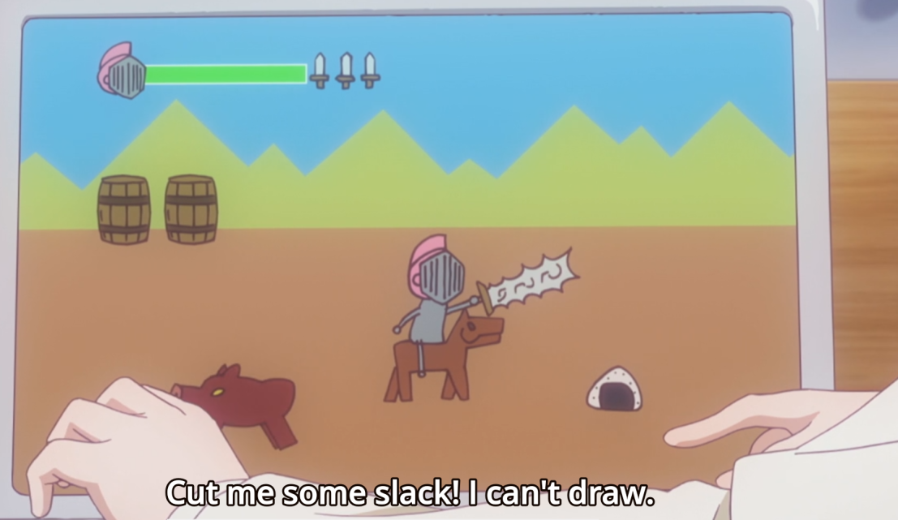
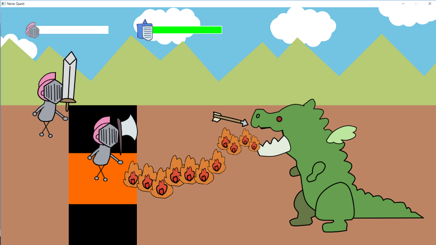

<p align="center"></p>

Reproduction of Nene Sakura's game "Nene Quest" from "New Game!!" (2nd
season, episode 3) written in C++ with the SFML library.

# Preview

## Original



## nene-quest



# Compilation & Execution

We currently don't have any release yet so you have to compile the
project by yourself. You need a C++17 compiler and [CMake][cmake] 3.21+.

The game uses SFML 2.6. If CMake can't find it on your system, it
downloads and builds it automatically (the first build takes a few
minutes). Pass `-DNENEQUEST_FETCH_SFML=ON` to always do that.

The game loads its assets relative to the current directory, so run it
from the `nenequest/` directory.

[cmake]: https://cmake.org/download/

## Nix

```sh
nix run          # build and play
nix develop      # shell with CMake, SFML, gdb and clangd
```

## Linux

1. Install CMake and SFML development files (or skip SFML and let
   CMake download it, which needs the X11, OpenGL, udev, FreeType,
   OpenAL, FLAC and Vorbis development packages instead)
   ```sh
   apt-get install cmake libsfml-dev # Ubuntu, Debian
   pacman -S cmake sfml # Arch Linux
   ```
2. Compile and execute:
   ```sh
   cd nenequest/
   cmake -B build . # -DCMAKE_BUILD_TYPE=Release
   cmake --build build
   ./build/NeneQuest
   ```

Builds are Debug by default, with UndefinedBehaviorSanitizer enabled.

## Windows

1. Install Visual Studio (with the "Desktop development with C++"
   workload) or another compiler such as MinGW-w64, and CMake.
2. In PowerShell:
   ```powershell
   cd nenequest
   cmake -B build .
   cmake --build build --config Release
   .\build\Release\NeneQuest.exe
   ```
   The SFML DLLs are copied next to the executable automatically.

Visual Studio can also open the `nenequest` folder directly, since it
understands CMake projects.

# Contributing

Please format the code before committing, with

``` sh
cd nenequest/
clang-format -i headers/**/*.hpp src/**/*.cpp
```
